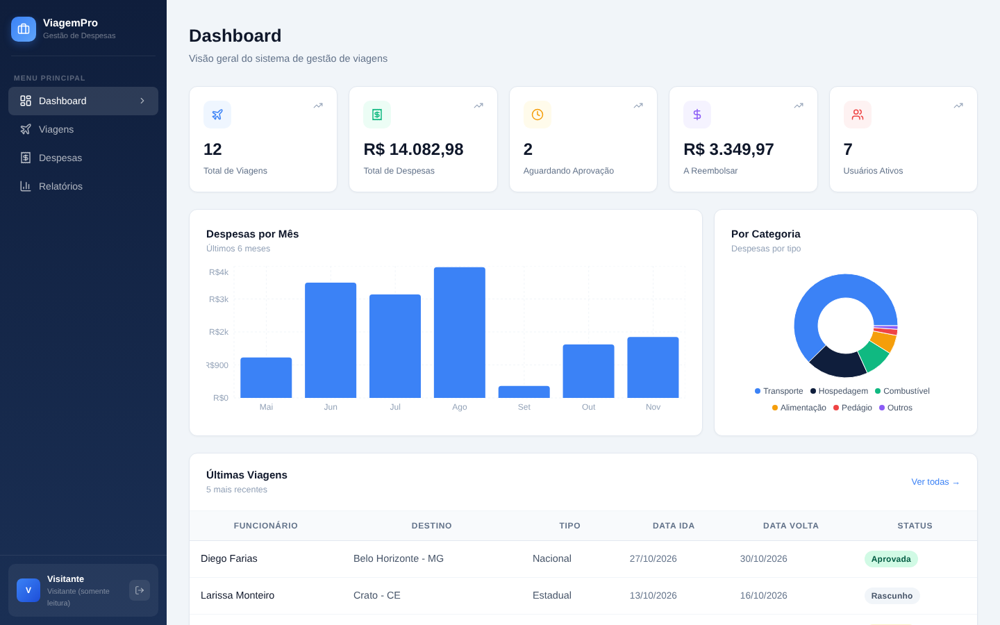
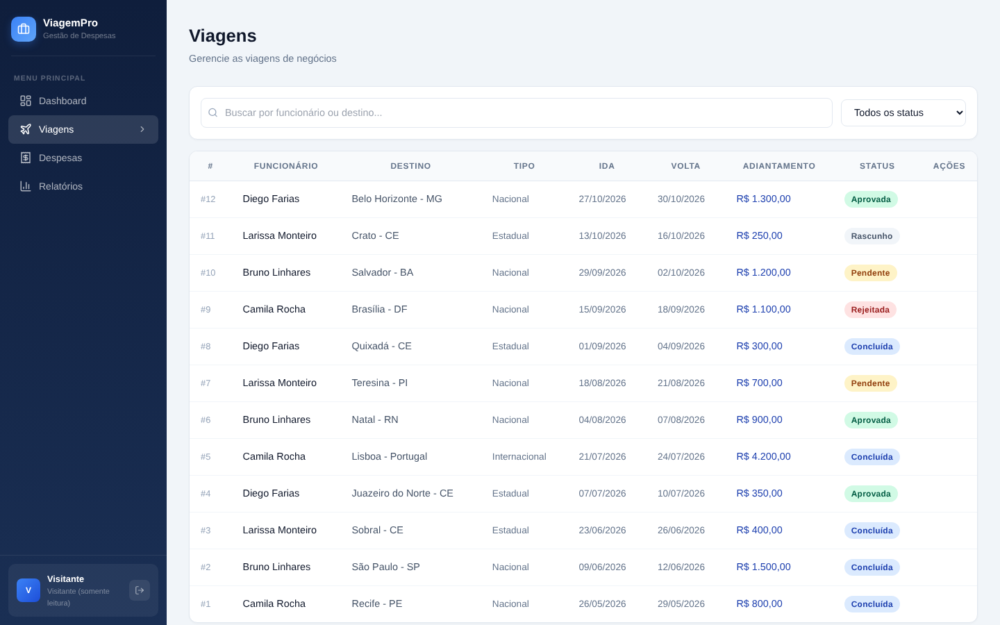
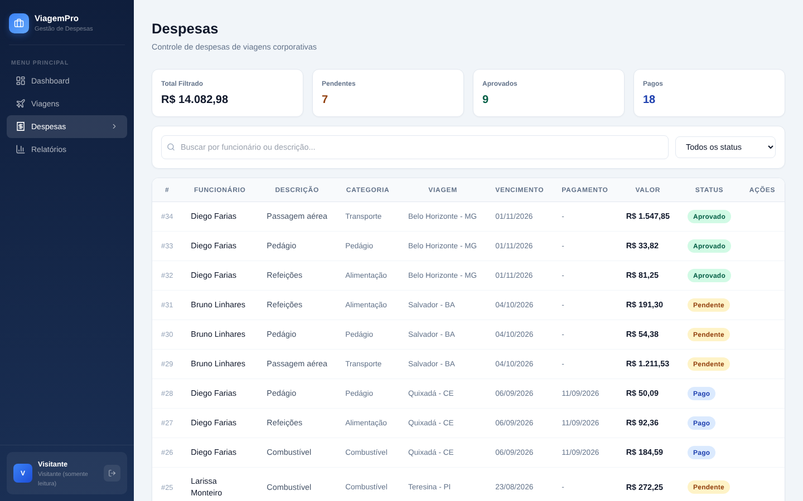
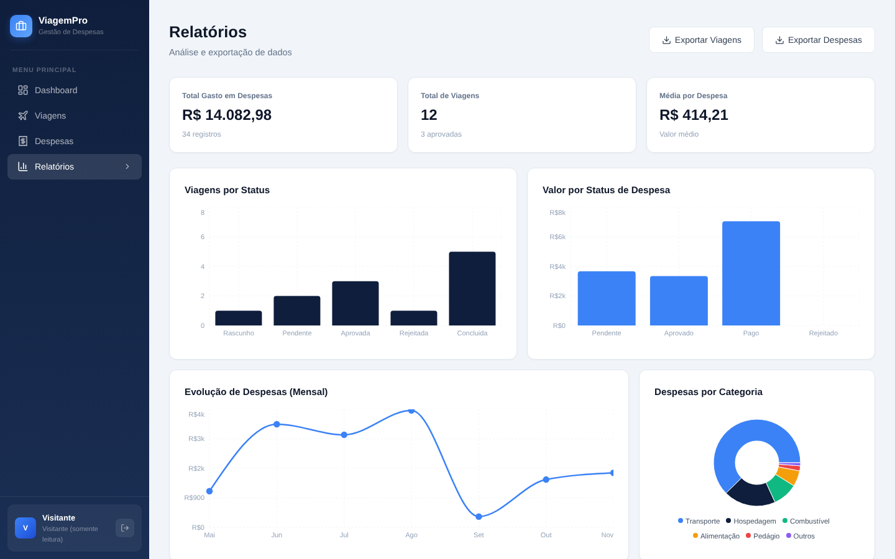

# ViagemPro


[](https://github.com/MChaves-21/controle-viagens/actions/workflows/ci.yml)


**🔗 Demo:** https://controle-viagens-black.vercel.app — clique em **Entrar como visitante** (somente leitura, sem cadastro)

Sistema web de gestão de despesas de viagens corporativas, desenvolvido com Next.js e MySQL. Permite que colaboradores registrem e acompanhem viagens de negócio, submetam despesas para aprovação e gerem relatórios financeiros — tudo em uma interface centralizada e responsiva.


| Dashboard | Viagens |
|---|---|
|  |  |
| **Despesas** | **Relatórios** |
|  |  |

<sub>Prints com dados fictícios (`seed-demo.sql`), no modo visitante.</sub>
---

## Funcionalidades

- **Autenticação** — login e cadastro com sessão JWT via cookie httpOnly, senhas com hash bcrypt e proteção de rotas por middleware
- **Dashboard** — visão geral com KPIs, gráfico de despesas mensais e distribuição por categoria
- **Viagens** — cadastro, edição e exclusão de viagens com controle de status (rascunho → pendente → aprovada → concluída)
- **Despesas** — lançamento de despesas vinculadas a viagens, com categorização, status de pagamento e URL de comprovante
- **Usuários** — gerenciamento de usuários com quatro perfis de acesso: Administrador, Gestor, Financeiro e Colaborador
- **Permissões no servidor** — cada perfil só faz o que lhe cabe, checado no middleware e nas rotas de API (não só escondendo botões)
- **Relatórios** — gráficos analíticos e exportação de dados em CSV

---

## Stack

| Camada | Tecnologia |
|--------|-----------|
| Frontend + API | Next.js 15 (App Router) |
| Banco de dados | MySQL 8 — Aiven Cloud |
| Autenticação | JWT com `jose` (edge-compatible) + bcrypt |
| Gráficos | Recharts |
| Deploy | Vercel |

---

## Estrutura do banco

O banco é dividido em três schemas:

```
seguranca
  └── tbUsuarios          — usuários e perfis de acesso

viagem
  ├── tbViagemTipo        — tipos (Nacional, Internacional, Estadual...)
  └── tbViagem            — viagens com status, adiantamento e aprovação

financeiro
  ├── tbTipoTitulo        — categorias de despesa (Transporte, Hospedagem...)
  └── tbContasPagar       — despesas e reembolsos vinculados às viagens
```

Para criar toda a estrutura, execute o arquivo `setup.sql` no banco:

```bash
mysql -h <DB_HOST> -P <DB_PORT> -u avnadmin -p --ssl-mode=REQUIRED < setup.sql
```

---

## Perfis e permissões

As regras ficam em `lib/permissions.js` e valem no servidor: chamar a API direto não fura o controle.

| Ação | Admin | Gestor | Financeiro | Colaborador |
|------|:-----:|:------:|:----------:|:-----------:|
| Criar, editar e excluir usuários | ✅ | — | — | — |
| Lançar viagens e despesas | ✅ | ✅ | ✅ | ✅ |
| Aprovar ou rejeitar viagens e despesas | ✅ | ✅ | — | — |
| Concluir viagem | ✅ | ✅ | ✅ | — |
| Marcar despesa como paga | ✅ | — | ✅ | — |

Na demonstração existe ainda o perfil **visitante**: o botão *Entrar como visitante* abre uma sessão sem senha e sem usuário no banco, que vê viagens, despesas, dashboard e relatórios, mas recebe `403` em qualquer criação, edição ou exclusão. Para desligar, defina `DEMO_MODE=off`.

---

## Testes

```bash
cd viagens-app
npm test
```

31 testes com **Vitest** cobrem as permissões por perfil (inclusive o visitante), o hash de senhas (inclusive a migração de senhas antigas), a validação do JWT e o middleware de rotas. O GitHub Actions roda os testes e o build a cada push.

---

## Variáveis de ambiente

Copie o `.env.example` para `.env.local` na pasta `viagens-app` e preencha:

```env
DB_HOST=<host-do-banco>
DB_PORT=<porta>
DB_USER=avnadmin
DB_PASSWORD=<senha>
DB_NAME=defaultdb
JWT_SECRET=<string-longa-e-aleatoria>
```

Na Vercel, configure as mesmas variáveis em **Settings → Environment Variables**.

---

## Dados de demonstração

Depois do `setup.sql`, o `seed-demo.sql` cria 6 pessoas, 12 viagens e 34 despesas **fictícias**, com datas relativas a hoje (o dashboard sempre tem os últimos 6 meses):

```bash
mysql --default-character-set=utf8mb4 ... < setup.sql
mysql --default-character-set=utf8mb4 ... < seed-demo.sql
```

Para rodar com um MySQL local sem SSL, use `DB_SSL=false`.

---

## Rodando localmente

```bash
cd viagens-app
npm install
npm run dev
# Acesse http://localhost:3000
```

---

## Deploy

1. Suba o repositório no GitHub
2. Importe o projeto na [Vercel](https://vercel.com) apontando para a pasta `viagens-app` como diretório raiz
3. Configure as variáveis de ambiente no painel
4. Clique em **Deploy**

---

## Primeiro acesso

O `setup.sql` cria um usuário administrador inicial (login `admin`) com uma senha provisória. No primeiro login a senha é convertida automaticamente para hash **bcrypt**. Troque essa senha antes de publicar o sistema e não reutilize credenciais de exemplo em produção.

---

## Estrutura de pastas

```
viagens-app/
├── app/
│   ├── api/              — rotas de API (auth, viagens, despesas, usuários)
│   ├── login/            — tela de login e cadastro
│   ├── viagens/          — módulo de viagens
│   ├── despesas/         — módulo de despesas
│   ├── usuarios/         — módulo de usuários
│   ├── relatorios/       — relatórios e gráficos
│   ├── layout.js         — layout global com sidebar e autenticação
│   └── page.js           — dashboard principal
├── lib/
│   ├── db.js             — pool de conexão MySQL
│   ├── auth.js           — utilitários JWT
│   ├── password.js       — hash bcrypt e migração de senhas antigas
│   ├── permissions.js    — regras de acesso por perfil
│   └── session.js        — usuário logado a partir do cookie
├── tests/                — testes Vitest
├── middleware.js          — proteção de rotas
├── setup.sql             — script de criação do banco
└── .env.local            — variáveis de ambiente (não versionar)
```
